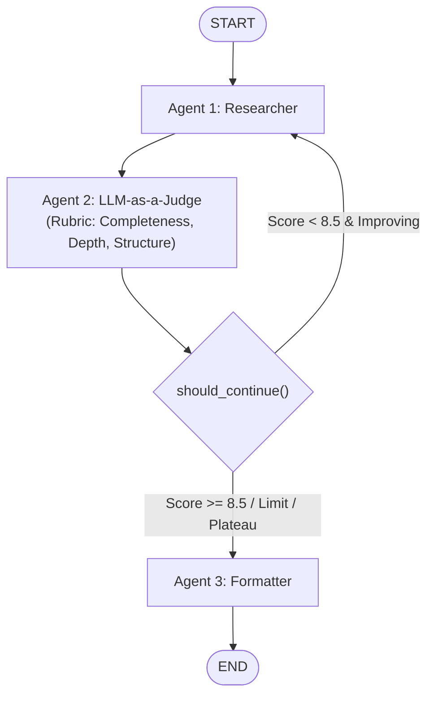

# 🤖 Autonomous Multi-Agent Research System
> Built with **LangGraph** and powered by **Google Gemini** (Gemini 2.5/3.8 Flash).

A production-grade learning repository tracking the evolution of building an autonomous, self-correcting multi-agent system from scratch.

---

## 📑 Table of Contents
1. [Why LangGraph? (Interview & Engineering Context)](#-why-langgraph-interview--engineering-context)
2. [Project Architecture & Directory Layout](#-project-architecture--directory-layout)
3. [Setup & Quick Start](#-setup--quick-start)
4. [Phase 1: Starting Low — The 4 Core LangGraph Primitives](#-phase-1-starting-low--the-4-core-langgraph-primitives)
5. [Phase 2: Multi-Agent Collaboration & Handoffs](#-phase-2-multi-agent-collaboration--handoffs)
6. [Phase 3: Cyclic Graphs & The Self-Correction Reflection Loop](#-phase-3-cyclic-graphs--the-self-correction-reflection-loop)
7. [Phase 4: LLM-as-a-Judge with Numerical Rubric & Plateau Detection](#-phase-4-llm-as-a-judge-with-numerical-rubric--plateau-detection)
8. [Phase 5: Conversational Session Memory with MemorySaver](#-phase-5-conversational-session-memory-with-memorysaver)
9. [Real Execution Walkthrough (Case Study)](#-real-execution-walkthrough-case-study)
10. [System Deep-Dive: State, Memory, & Context Size](#-system-deep-dive-state-memory--context-size)
11. [Interview Q&A Cheat Sheet](#-interview-qa-cheat-sheet)

---

## 🎯 Why LangGraph? (Interview & Engineering Context)

In modern AI Engineering, single-prompt calls and linear chains (DAGs) fail when solving non-trivial tasks because:
- **Linear chains cannot self-correct**: If step 2 hallucinates or misses edge cases, step 3 blindly operates on bad data.
- **Vendor APIs are black boxes**: Relying exclusively on proprietary agent APIs locks organizations in and prevents custom state orchestration, persistence, and local execution.

**LangGraph** solves this by modeling agent systems as **state machines** with support for **cycles (feedback loops)**, **conditional branching**, and **isolated agent states**.

---

## 📁 Project Architecture & Directory Layout

The codebase follows strict decoupling principles. The runner CLI ([main.py](file:///Users/payalchoudhary979/Documents/AI_Agents_apps/multi-agent-research-system/main.py)) remains untouched, while all agent nodes, routing logic, and schemas reside inside `core/`.

```
multi-agent-research-system/
├── .env                  # Private API keys (GEMINI_API_KEY)
├── requirements.txt      # Dependencies (langgraph, langchain-google-genai, etc.)
├── main.py               # Decoupled CLI entrypoint (User terminal interface)
├── logs/                 # Timestamped session logs (one file per CLI session until Ctrl+C)
├── core/
│   ├── __init__.py       # Package marker
│   ├── llm.py            # Standard Gemini API client (HTTP / SDK integration)
│   ├── logger.py         # Session-level Logger (records entire interactive session)
│   └── graph.py          # State schema, Agent Nodes, Conditional Edges & Graph Engine
├── .agents/skills/       # Antigravity Skills directory
│   └── langgraph-multi-agent-system/SKILL.md # Persistent system skill runbook
└── README.md             # Complete system documentation
```

---

## 🚀 Setup & Quick Start

### 1. Install Dependencies
```bash
pip install -r requirements.txt
```

### 2. Configure Your API Key
Create a `.env` file at the root:
```bash
GEMINI_API_KEY=your_gemini_api_key_here
```

### 3. Run the System
```bash
python main.py
```

---

## 🧱 Phase 1: Starting Low — The 4 Core LangGraph Primitives

Every LangGraph system is built upon four foundational building blocks:

### 1. State (The Shared Clipboard)
A typed schema (using Python's `TypedDict`) that flows between all nodes.
```python
from typing import TypedDict, Optional

class ResearchState(TypedDict):
    prompt: str
    response: Optional[str]
    step_count: int
```

### 2. Nodes (The Workers)
Pure Python functions that take the current `state`, execute work (LLM call, calculation, web lookup), and return a dictionary of fields to update.
```python
def generate_node(state: ResearchState) -> dict:
    prompt = state["prompt"]
    answer = call_gemini(prompt)
    return {
        "response": answer,
        "step_count": state["step_count"] + 1
    }
```

### 3. Edges (The Conveyor Belt)
Define the execution direction between nodes.
```python
from langgraph.graph import StateGraph, START, END

workflow = StateGraph(ResearchState)
workflow.add_node("generator", generate_node)

# Flow: START -> generator -> END
workflow.add_edge(START, "generator")
workflow.add_edge("generator", END)
```

### 4. Compilation & Invocation
Compiling creates an executable `Runnable` state machine:
```python
app = workflow.compile()
final_state = app.invoke({"prompt": "Explain AI in 5 words", "response": None, "step_count": 0})
```

---

## 🤝 Phase 2: Multi-Agent Collaboration & Handoffs

In Phase 2, we separated cognitive concerns by splitting the single node into two specialized agents:

```
START ───► [ Agent 1: Researcher ] ───► [ Agent 2: Reviewer ] ───► END
```

### The State Contract:
```python
class ResearchState(TypedDict):
    prompt: str
    draft: Optional[str]         # Written by Agent 1
    final_report: Optional[str]  # Written by Agent 2
    step_count: int
```

### The Two Agents:
- **Agent 1 (`researcher_node`)**: Focuses 100% on comprehensive factual research, data gathering, and technical substance. Populates `state["draft"]`.
- **Agent 2 (`reviewer_node`)**: Reads `state["draft"]`, strips fluff, restructures the content, and formats an executive-ready brief. Populates `state["final_report"]`.

### The Edge Wiring (Handoff):
```python
workflow.add_node("researcher", researcher_node)
workflow.add_node("reviewer", reviewer_node)

workflow.add_edge(START, "researcher")
workflow.add_edge("researcher", "reviewer")  # Agent 1 hands off to Agent 2
workflow.add_edge("reviewer", END)
```

---

## 🔁 Phase 3: Cyclic Graphs & The Self-Correction Reflection Loop

Linear pipelines cannot fix mistakes. Phase 3 introduces **Cyclic Graphs** using the **Reflection Agent Pattern**:

```
                     ┌──────────────────────────────┐
                     ▼                              │
START ───► [ Agent 1: Researcher ] ───► [ Agent 2: Reviewer ] ───► END
                                                │ (Needs Revision)
                                                └──────────────┘
```

The Reviewer inspects the draft and if improvements are needed, routes execution back to the Researcher with constructive critique.

---

## ⚖️ Phase 4: LLM-as-a-Judge with Numerical Rubric & Plateau Detection

In production systems with multiple potential retries (e.g., up to 3–5 iterations), subjective "is this good?" reviews create **moving goalposts** where agents loop indefinitely.

Phase 4 introduces an **LLM-as-a-Judge (Evaluator-Optimizer pattern)** using:
1. **Multi-Dimensional Rubric**: Independent scoring on *Completeness* (1-10), *Technical Depth* (1-10), and *Structure* (1-10).
2. **Deterministic Quality Gate**: Score $\ge 8.5/10$ required to approve.
3. **Plateau Detection**: If improvement between consecutive iterations is $< 0.2$ points ($\Delta < 0.2$), execution halts early to prevent diminishing returns and token waste.
4. **Targeted Gap Correction**: The Researcher receives only the specific gap checklist where points were lost.



### The State Contract with Evaluation Schema:
```python
class Evaluation(TypedDict):
    completeness: int
    technical_depth: int
    structure: int
    overall_score: float
    gaps: List[str]

class ResearchState(TypedDict):
    prompt: str
    draft: Optional[str]
    evaluation: Optional[Evaluation]
    score_history: List[float]       # Tracks progression: [6.7, 8.2, ...]
    final_report: Optional[str]
    revision_count: int
    exit_reason: Optional[str]
```

### The Deterministic Routing Logic:
```python
def should_continue(state: ResearchState) -> str:
    score = state["evaluation"]["overall_score"]
    history = state.get("score_history", [])
    count = state.get("revision_count", 0)

    # 1. Quality Target Met!
    if score >= TARGET_SCORE:  # 8.5
        return "finalize"

    # 2. Hard Circuit Breaker
    if count >= MAX_REVISIONS:  # 3
        return "finalize"

    # 3. Plateau Detection (Anti-Waste Guardrail)
    if len(history) >= 2 and (history[-1] - history[-2]) < PLATEAU_THRESHOLD: # 0.2
        return "finalize"

    # 4. Under target and improving -> Revise!
    return "revise"
```

---

## 🧠 Phase 5: Conversational Session Memory with MemorySaver

Without persistence, each prompt starts with a completely blank state. When a user asks follow-up questions (e.g., *"Now compare that name with Alexander"* or *"You remember we were talking about Siddharth"*), the agents have no recollection of prior turns.

Phase 5 introduces **Multi-Turn Session Memory** using LangGraph's **`MemorySaver` Checkpointer** and **State Reducers**:

### 1. The State Reducer (`operator.add`)
Instead of overwriting previous messages, the reducer tells LangGraph to **accumulate and append** new turns to the existing list:
```python
import operator
from typing import Annotated, List, TypedDict

class ResearchState(TypedDict):
    prompt: str
    chat_history: Annotated[List[dict], operator.add]  # 🆕 Automatically appends across turns!
    draft: Optional[str]
    evaluation: Optional[Evaluation]
    score_history: List[float]
    final_report: Optional[str]
    revision_count: int
    exit_reason: Optional[str]
```

### 2. Compiling with `MemorySaver`
```python
from langgraph.checkpoint.memory import MemorySaver

checkpointer = MemorySaver()
app = workflow.compile(checkpointer=checkpointer)
```

### 3. Thread-Aware Invocations
When invoking the graph, passing a `thread_id` config instructs `MemorySaver` to look up existing state for that thread:
```python
config = {"configurable": {"thread_id": "session_20261114_030000"}}
result = app.invoke(initial_state, config=config)
```

### 4. Conversational Awareness in Agent Prompts
Agent 1 (`researcher_node`) reviews the accumulated `chat_history`:
```python
if chat_history:
    history_context = "Previous Conversation History:\n" + ...
    researcher_prompt = f"{history_context}Current User Query: {prompt}"
```
This enables agents to carry forward context, acknowledge earlier topics, and answer comparative or contextual follow-ups seamlessly!

---

## 🔬 Real Execution Walkthrough (Case Study)

Here is the exact live trace generated by our system:

### User Query:
> *"I want to make a multi agent code review system using lang graph which can test the changes and if any edge case fail it should be able to make changes again"*

### Live Terminal Execution Trace:
```text
👉 Enter prompt: I want to make a multi agent code review system using lang graph which can test the changes and if any edge case fail it should be able to make changes again 

Thinking...
  [LangGraph Agent 1: 'researcher' gathering initial facts (Revision 0)...]
  [LangGraph Agent 2: 'judge' evaluating draft against rubric...]
  ┌── 📊 LLM Judge Scorecard ──────────────────────┐
  │  • Completeness:     8/10
  │  • Technical Depth:  7/10
  │  • Structure:        8/10
  │  ⭐ Overall Score:    7.7/10 (Target: 8.5/10)
  │  ⚠️  Key Gap: Address State Accumulation Bug...
  └────────────────────────────────────────────────┘
  [Routing Decision 🔁]: Score (7.7/10) < 8.5. Looping back to Researcher.

  [LangGraph Agent 1: 'researcher' targeting specific gaps (Revision 1)...]
  [LangGraph Agent 2: 'judge' evaluating draft against rubric...]
  ┌── 📊 LLM Judge Scorecard ──────────────────────┐
  │  • Completeness:     9/10
  │  • Technical Depth:  9/10
  │  • Structure:        9/10
  │  ⭐ Overall Score:    9.0/10 (Target: 8.5/10)
  └────────────────────────────────────────────────┘
  [Routing Decision ✅]: Target achieved (9.0/10)! Routing to Formatter.

  [LangGraph Formatter: Producing final deliverable (Target Quality Met)...]
```

---

## 🧠 System Deep-Dive: State, Memory, & Context Size

### 1. State Management (Partial Merging)
- In LangGraph, nodes do not need to return the entire state.
- When `researcher_node` returns `{"draft": "...", "revision_count": 1}`, LangGraph automatically **shallow-merges** those keys into the state dictionary while preserving unmodified keys (`prompt`).

### 2. Memory Tiers in Agent Systems
| Tier | Status in Our System | Purpose |
| :--- | :--- | :--- |
| **Working Memory** | ✅ Implemented | The active `ResearchState` dictionary during a single `graph.invoke()` run. |
| **Conversational Memory** | 🔄 Ready for Checkpointers | Multi-turn persistence across queries using `MemorySaver` and `thread_id`. |
| **Long-Term Memory** | 🔮 Future Expansion | Vector databases (ChromaDB / Pinecone) for historical retrieval. |

### 3. Context Size & Token Economy
- **Agent 1 (Round 1)**: Sends user query ($\approx 35\text{ tokens}$), generates draft ($\approx 800\text{ tokens}$).
- **LLM Judge**: Evaluates draft against rubric, emits JSON scorecard ($\approx 120\text{ tokens}$).
- **Agent 1 (Round 2)**: Ingests draft + targeted gaps ($\approx 950\text{ tokens}$), resolves issues ($\approx 1,200\text{ tokens}$).
- **Total Run**: $\approx 3,500\text{ tokens}$ utilized out of Gemini's **1,000,000+ token context window** ($< 0.35\%$ capacity).

---

## 🎓 Interview Q&A Cheat Sheet

If asked about this project in technical or system design interviews:

#### Q1: "Why did you use LangGraph instead of a simple linear chain?"
> *"Linear chains assume every step succeeds without flaws. In complex research, quality requires self-correction. LangGraph allows cyclical graphs where an LLM Judge can evaluate drafts, identify specific gaps, and route execution back to the Researcher with targeted critique before finalizing."*

#### Q2: "How do you prevent moving-goalpost infinite loops during self-correction?"
> *"We implement three complementary guardrails: 1) A structured numerical rubric with an explicit threshold (e.g. 8.5/10), 2) A hard revision limit (`MAX_REVISIONS = 3`), and 3) Plateau detection ($\Delta < 0.2$), halting execution if score improvements stagnate."*

#### Q3: "How does the Researcher know what to fix without rewriting everything?"
> *"The LLM Judge outputs structured JSON with a `gaps` list. In subsequent cycles, the Researcher specifically targets only the identified deficiencies rather than blindly regenerating the entire report."*

#### Q4: "How does state pass between agents?"
> *"Through a typed `StateGraph(ResearchState)` contract. Each node returns only the partial dictionary delta it modifies. LangGraph merges these updates into the shared state snapshot before transitioning to the next node."*
